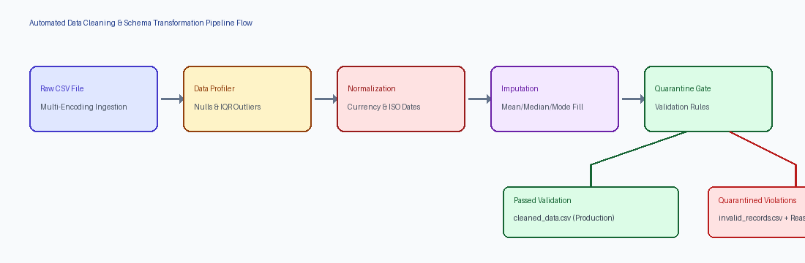
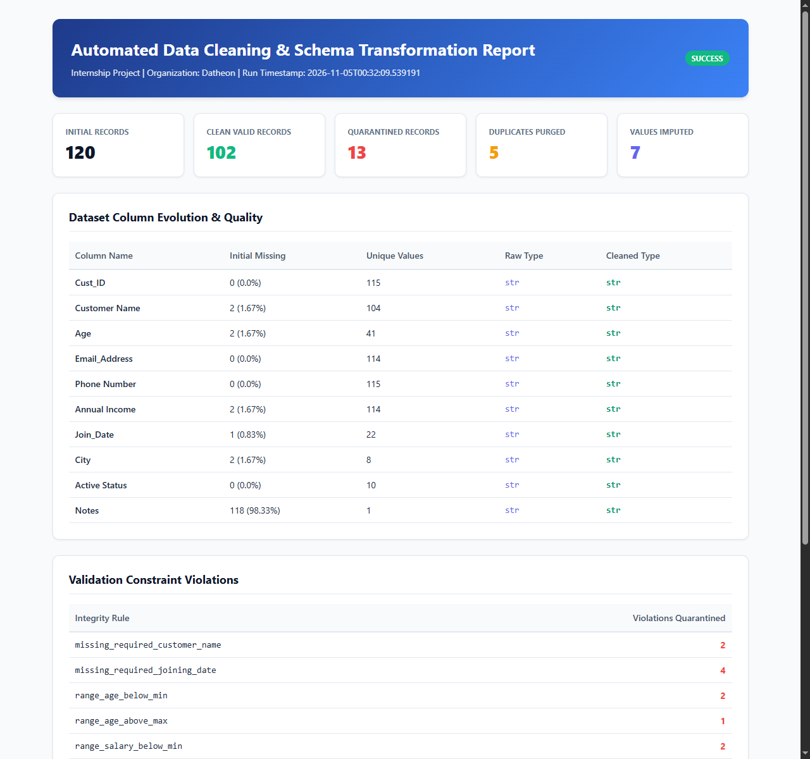
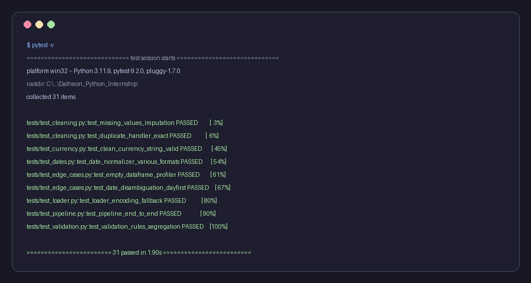

# Datheon Python for Data Engineering & Automation Internship

[](https://www.python.org/)
[](Task_2_Automated_Data_Cleaning/tests/)
[](https://streamlit.io/)
[](https://pep8.org/)
[]()

> **Candidate:** Deevakar Kumar  
> **Track:** Python for Data Engineering & Automation Internship  
> **Host Organization:** Datheon  
> **Repository:** `Datheon_Python_for_Data_Engineering_-_Automation_Internship`

---

## 📌 Repository Overview

This repository houses the end-to-end deliverables for the **Datheon Python for Data Engineering & Automation Internship**. Each task is organized in a self-contained, modular directory equipped with its own source code, automated test suite, configuration schemas, and documentation.

| Milestone | Task Description | Status | Primary Technologies |
| :---: | :--- | :---: | :--- |
| **Task 2** | **Automated Data Cleaning & Schema Transformation Engine** |  **Completed** | Python, Pandas, NumPy, Pytest, Streamlit, JSON |
| **Task 3** | **Upcoming Data Engineering & Automation Milestone** | 🔄 *Next Deliverable* | Python, Automation & Data Systems |

---

## ⚡ Task 2: Automated Data Cleaning & Schema Transformation Engine

A production-style, rule-driven ETL pipeline designed to ingest unstandardized CSV files, normalize disparate data conventions, prune corrupt records, enforce schema contracts, and generate executive audit dashboards.

### 🖼️ Pipeline Architecture & Workflow



```
[ Dirty CSV ] ──▶ [ Ingestion & Profiling ] ──▶ [ Normalization & Imputation ] ──▶ [ Data Quarantine Protocol ]
                                                                                           │
                                                                   ┌───────────────────────┴───────────────────────┐
                                                                   ▼                                               ▼
                                                          [ Clean Production Data ]                      [ Quarantined Records ]
                                                             cleaned_data.csv                              invalid_records.csv
```

---

### 🌟 Key Engineering Highlights

1. **Multi-Encoding Ingestion**: Automatically detects and falls back across `utf-8`, `latin1`, and `cp1252` encodings while guarding against 0-byte corrupted files.
2. **Automated Diagnostic Profiler**: Pre-cleaning inspection extracting null percentages, uniqueness cardinalities, and statistical outliers via **Interquartile Range ($IQR = Q_3 - Q_1$)**.
3. **Deterministic Currency & Date Normalizer**: Strips international currency markers (`₹`, `INR`, `Rs.`, `$`, `€`, accounting negatives `(1,500)`) into `float64` and parses polymorphic date conventions into ISO `YYYY-MM-DD`.
4. **Data Quarantine Protocol**: Isolates corrupt and out-of-boundary records into `invalid_records.csv` alongside granular `rejection_reasons` rather than silently dropping data.
5. **Interactive Streamlit Web Dashboard**: Visual UI allowing users to upload datasets, inspect live transformations, and download cleaned or quarantined datasets.
6. **Executive Audit Reporting**: Exports machine-readable `validation_report.json` and a styled HTML quality dashboard (`cleaning_summary.html`).
7. **Production Logging**: Employs Python `RotatingFileHandler` (5MB rollover, 3 backups) to eliminate storage bloat.

---

### 📊 Executive Quality Dashboard Preview

The pipeline automatically compiles an executive visual HTML report summarizing transformation metrics, column type migrations, and constraint violations:



---

### 🧪 Automated Test Suite (31 Passed)

The project includes an automated **pytest** test suite with 31 unit, integration, and negative boundary test cases covering empty DataFrames, structural corruption, date disambiguation, and schema integrity:



```cmd
============================= 31 passed in 1.90s ==============================
```

---

### 🚀 Quickstart & How to Run Task 2

#### 1. Setup Virtual Environment
```powershell
# Clone the repository
git clone https://github.com/deevakarkumar/Datheon_Python_for_Data_Engineering_-_Automation_Internship.git
cd Datheon_Python_for_Data_Engineering_-_Automation_Internship/Task_2_Automated_Data_Cleaning

# Create and activate virtual environment
python -m venv venv
.\venv\Scripts\Activate.ps1

# Install dependencies
pip install -r requirements.txt
```

#### 2. Launch Interactive Streamlit Web UI
```powershell
streamlit run app.py
```
*Open your browser at `http://localhost:8501` to test with sample data or upload custom files.*

#### 3. Run Pipeline via Command-Line Interface (CLI)
```powershell
# Run end-to-end cleaning pipeline
python main.py

# Profile dataset without modifying data
python main.py --profile-only

# Run with custom input and verbose debug logs
python main.py -i data/raw/sample_messy_data.csv -c config/schema_config.json -o data/output --verbose
```

#### 4. Run Automated Pytest Suite
```powershell
pytest -v
```

---

### 📁 Repository Structure

```text
Datheon_Python_for_Data_Engineering_-_Automation_Internship/
│
├── README.md                                  # Master internship documentation
├── requirements.txt                           # Project-wide dependencies
├── screenshots/                               # Visual previews & test execution cards
│   ├── architecture_diagram.png
│   ├── executive_dashboard.png
│   └── pytest_results.png
│
├── Task_2_Automated_Data_Cleaning/            # Milestone 2 Root
│   ├── app.py                                 # Interactive Streamlit Web Application
│   ├── main.py                                # CLI execution entry point
│   ├── requirements.txt                       # Task-specific dependencies
│   ├── README.md                              # Deep-dive technical documentation
│   │
│   ├── config/
│   │   └── schema_config.json                 # Decoupled schema, casting & validation rules
│   │
│   ├── data/
│   │   ├── raw/
│   │   │   └── sample_messy_data.csv          # Real-world dirty dataset (120 rows)
│   │   └── output/
│   │       ├── cleaned_data.csv               # Type-safe production dataset
│   │       ├── invalid_records.csv            # Quarantined rows with rejection reasons
│   │       ├── validation_report.json         # Machine-readable audit metrics
│   │       ├── cleaning_summary.html          # Executive quality dashboard
│   │       └── cleaning.log                   # Rotating execution trace
│   │
│   ├── src/                                   # Single-responsibility ETL modules
│   │   ├── loader.py                          # Resilient multi-encoding ingestion
│   │   ├── profiler.py                        # Pre-cleaning statistics & IQR outliers
│   │   ├── currency.py                        # Vectorized currency normalizer
│   │   ├── dates.py                           # ISO date standardization engine
│   │   ├── missing_values.py                  # Missing value imputation & pruning
│   │   ├── duplicates.py                      # Exact & primary key deduplication
│   │   ├── schema_transformer.py              # Snake_casing, aliases & type casting
│   │   ├── validator.py                       # Business rules & quarantine engine
│   │   ├── reporter.py                        # HTML & JSON report generators
│   │   └── pipeline.py                        # Orchestrator & rotating file logger
│   │
│   └── tests/                                 # Pytest automated test suite (31 tests)
│       ├── test_loader.py
│       ├── test_currency.py
│       ├── test_dates.py
│       ├── test_cleaning.py
│       ├── test_schema.py
│       ├── test_validation.py
│       ├── test_edge_cases.py
│       └── test_pipeline.py
│
└── Task_3_Upcoming_Task/                      # Milestone 3 (In Progress / Next Deliverable)
```

---

## 👨‍💻 Author

**Deevakar Kumar**  
- **GitHub**: [@deevakarkumar](https://github.com/deevakarkumar)  
- **Email**: `deevakarkumarthakur@gmail.com`  
- **Internship Track**: Python for Data Engineering & Automation  
- **Organization**: Datheon
