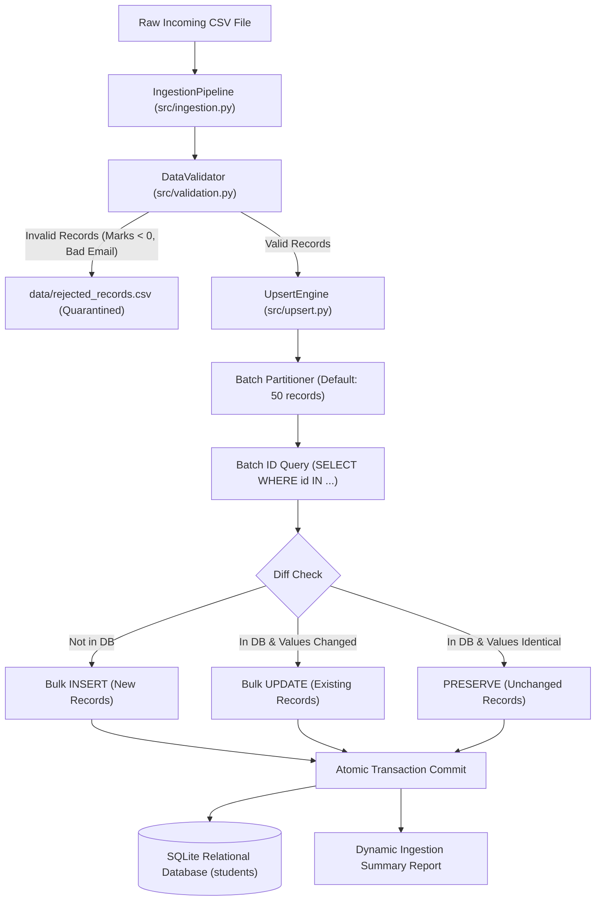
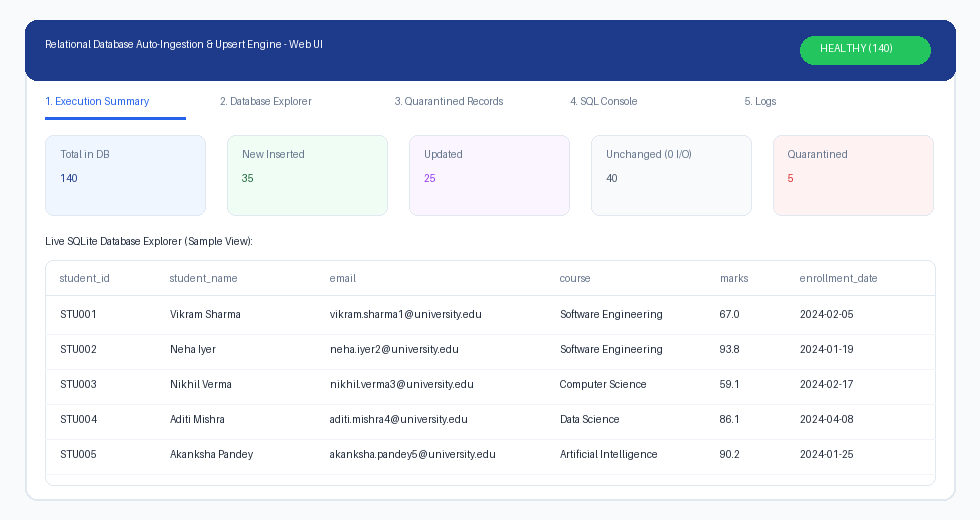
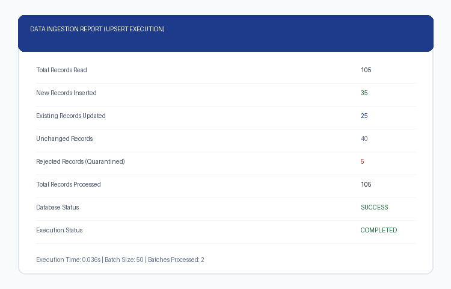
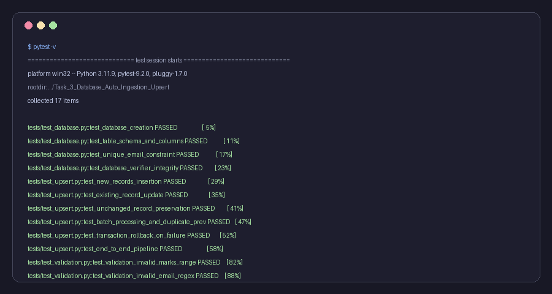

# Datheon Python for Data Engineering & Automation Internship

[](https://www.python.org/)
[-brightgreen.svg)](tests/)
[](https://www.sqlalchemy.org/)
[](https://www.sqlite.org/)
[](https://streamlit.io/)
[](https://pep8.org/)
[]()

> **Candidate:** Deevakar Kumar  
> **Internship Track:** Python for Data Engineering & Automation Internship  
> **Host Organization:** Datheon  
> **Public Repository:** `Datheon_Python_for_Data_Engineering_-_Automation_Internship`

---

## 📌 Internship Portfolio Overview

This repository contains the completed, production-ready deliverables for the **Datheon Python for Data Engineering & Automation Internship**. Both required milestones have been implemented from scratch following modular, decoupled enterprise design patterns, ACID-compliant database transactions, automated data quality gates, and exhaustive **pytest** test suites.

| Milestone | Project Title | Status | Automated Tests | Technologies |
| :---: | :--- | :---: | :---: | :--- |
| **Task 2** | **Automated Data Cleaning & Schema Transformation Engine** | **Completed** | **31 Passed** | Python, Pandas, NumPy, Pytest, Streamlit, JSON |
| **Task 3** | **Relational Database Auto-Ingestion & Upsert Engine** | **Completed** | **17 Passed** | Python, SQLAlchemy 2.0, SQLite, Pandas, Pytest, Argparse |
| **Total** | **End-to-End Data Engineering Pipeline Deliverables** | **100% Ready** | **48 Passed** | Production Data Engineering Architecture |

---

## ⚡ Task 2: Automated Data Cleaning & Schema Transformation Engine

A modular, rule-driven ETL pipeline designed to ingest messy CSV files across multi-encodings, normalize currencies and ambiguous dates, impute missing values, prune non-informative attributes, and quarantine corrupt rows into an audited dataset.

### 🖼️ Pipeline Architecture & Workflow


### 🌟 Key Highlights
- **Vectorized Normalization**: Converts mixed currencies (`₹`, `INR`, `Rs.`, `$`, `€`) and polymorphic date formats into clean `float64` and ISO `YYYY-MM-DD`.
- **Data Quarantine Protocol**: Isolates invalid records to `invalid_records.csv` with explicit `rejection_reasons`.
- **Interactive Streamlit Web Dashboard**: Live web UI (`streamlit run app.py`) with side-by-side table comparisons and CSV export.
- **Executive Audit Dashboard**: Automatically outputs a styled, zero-dependency HTML dashboard (`cleaning_summary.html`).


```powershell
# Run Task 2 CLI
cd Task_2_Automated_Data_Cleaning
python main.py

# Run Task 2 Web Dashboard
streamlit run app.py

# Run Task 2 Automated Tests (31 Passed)
pytest -v
```


---

## 🗄️ Task 3: Relational Database Auto-Ingestion & Upsert Engine

An automated, transaction-safe ingestion system that reads structured CSV data, enforces data quality boundaries, and automatically executes batched **INSERT OR UPDATE (upsert)** operations into an SQLite relational database without creating duplicate records or redundant writes.

### 🖼️ Upsert Architecture & Data Flow



### 🌟 Key Highlights
- **Interactive Streamlit Web Dashboard**: Live browser UI (`streamlit run app.py` on port 8502) with live SQLite table explorer, one-click upsert trigger, and interactive SQL console.
- **Intelligent Field-Level Diffing**: Detects new vs. modified vs. unchanged records. Unchanged records trigger zero redundant writes.
- **Strict Data Quality Gate**: Validates email regex, enforces marks within $[0.0, 100.0]$, checks ISO date formatting, and quarantines intra-batch duplicate keys.
- **Transactional Atomicity**: Built on SQLAlchemy 2.0 session contexts (`with get_session()`), ensuring automatic rollback on failure and 100% database consistency.
- **Self-Healing Verification**: Built-in verification module executing SQLite `PRAGMA integrity_check` and confirming 0 duplicate primary keys or emails.



### 📊 Dynamic Execution Report



```powershell
# 1. Launch Task 3 Interactive Web Dashboard (Recommended for Evaluators)
cd Task_3_Database_Auto_Ingestion_Upsert
streamlit run app.py

# 2. Or Run via CLI:
# Initialize Relational Database Schema
python main.py init

# Ingest Initial Dataset (105 Fresh Inserts)
python main.py ingest --file data/students.csv

# Ingest Updated Dataset (Demonstrating Upsert & Quarantine)
python main.py ingest --file data/students_updated.csv --batch-size 50

# Verify Database Integrity & Constraints
python main.py verify

# Inspect Stored Database Records
python main.py report --limit 10

# Run Task 3 Automated Tests (17 Passed)
pytest -v
```



---

## 📁 Repository Structure

```text
Datheon_Python_for_Data_Engineering_-_Automation_Internship/
│
├── README.md                                  # Master internship documentation
├── requirements.txt                           # Global project dependencies
├── screenshots/                               # Visual dashboards & pytest execution cards
│   ├── architecture_diagram.png
│   ├── executive_dashboard.png
│   ├── pytest_results.png
│   ├── task3_ingestion_report.png
│   └── task3_pytest_results.png
│
├── Task_2_Automated_Data_Cleaning/            # Milestone 2: Cleaning & Schema Transformation
│   ├── app.py                                 # Interactive Streamlit Web UI
│   ├── main.py                                # CLI execution entry point
│   ├── requirements.txt                       # Task 2 dependencies
│   ├── README.md                              # Deep-dive technical documentation
│   ├── config/
│   │   └── schema_config.json                 # Decoupled schema & validation rules
│   ├── data/
│   │   ├── raw/sample_messy_data.csv          # Real-world dirty dataset (120 rows)
│   │   └── output/                            # Clean data, quarantine CSV & HTML reports
│   ├── src/                                   # Single-responsibility ETL modules
│   └── tests/                                 # Pytest test suite (31 tests passed)
│
└── Task_3_Database_Auto_Ingestion_Upsert/     # Milestone 3: Database Auto-Ingestion & Upsert
    ├── main.py                                # CLI with init, ingest, verify, report commands
    ├── config.py                              # Centralized configuration & file paths
    ├── requirements.txt                       # Task 3 dependencies (SQLAlchemy, Pandas, etc.)
    ├── README.md                              # Deep-dive technical documentation
    ├── database/
    │   └── database.db                        # SQLite relational database storage
    ├── data/
    │   ├── students.csv                       # Initial dataset (105 records)
    │   ├── students_updated.csv               # Updated dataset (105 records)
    │   └── rejected_records.csv               # Quarantined rows with explicit failure reasons
    ├── logs/
    │   └── ingestion.log                      # Rotating execution trace
    ├── src/
    │   ├── db_connection.py                   # SQLAlchemy engine & transaction manager
    │   ├── schema.py                          # Student ORM model & table provisioning
    │   ├── validation.py                      # Multi-rule data validator & quarantine engine
    │   ├── upsert.py                          # Batched atomic INSERT OR UPDATE engine
    │   ├── ingestion.py                       # Pipeline orchestrator
    │   ├── verification.py                    # Database integrity auditor & inspector
    │   └── reporting.py                       # Execution summary report generator
    └── tests/                                 # Pytest test suite (17 tests passed)
```

---

## 🧪 Comprehensive Automated Test Suites (48 Tests Passed)

Both tasks have completely isolated test environments using temporary SQLite databases (`tmp_path`) and synthetic fixtures:

| Module | Test File | Test Focus | Passed |
| :--- | :--- | :--- | :---: |
| **Task 2** | `tests/test_loader.py` | Ingestion, encodings & empty file checks | 4 |
| **Task 2** | `tests/test_currency.py` | Multi-currency regex stripping & negative parsing | 14 |
| **Task 2** | `tests/test_dates.py` | ISO standardization & day-first disambiguation | 2 |
| **Task 2** | `tests/test_cleaning.py` | Imputation strategies & deduplication | 2 |
| **Task 2** | `tests/test_schema.py` | Snake_casing & dtype casting | 2 |
| **Task 2** | `tests/test_validation.py` | Range checks & quarantine segregation | 1 |
| **Task 2** | `tests/test_edge_cases.py` | Empty DataFrames & boundary values | 5 |
| **Task 2** | `tests/test_pipeline.py` | End-to-end ETL integration | 1 |
| **Task 3** | `tests/test_database.py` | Schema creation, unique constraints & PRAGMA audits | 4 |
| **Task 3** | `tests/test_validation.py` | Email regex, marks ranges, intra-batch duplicates | 7 |
| **Task 3** | `tests/test_upsert.py` | Inserts, updates, unchanged rows & transaction rollbacks | 6 |
| **Total** | | **Complete Production Test Coverage** | **48 / 48** |

---

## 👨‍💻 Author

**Deevakar Kumar**  
- **GitHub**: [@deevakarkumar](https://github.com/deevakarkumar)  
- **Email**: `deevakarkumarthakur@gmail.com`  
- **Internship Track**: Python for Data Engineering & Automation  
- **Host Organization**: Datheon
