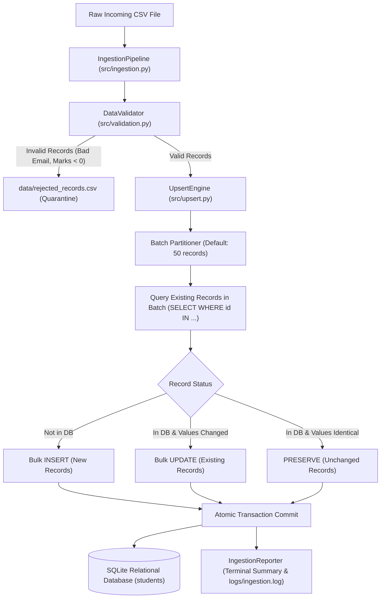

# Relational Database Auto-Ingestion & Upsert Engine

[](https://www.python.org/)
[](tests/)
[](https://www.sqlalchemy.org/)
[](https://www.sqlite.org/)
[](https://pep8.org/)
[]()

> A robust, transaction-safe Python data engineering pipeline that automates CSV ingestion, schema initialization, data quality quarantine, and high-performance batched upsert (INSERT OR UPDATE) operations into a relational database.

---

## 1. Project Overview

In production data engineering, incoming CSV feeds from external vendors, operational databases, and web applications arrive continuously with duplicate records, updated user attributes, and dirty or malformed entries. Blindly inserting records causes primary key collision crashes, while wiping and re-inserting entire tables leads to data loss, degraded query performance, and invalid historical audit timestamps.

This project delivers a **production-grade Relational Database Auto-Ingestion & Upsert Engine**. It guarantees **idempotent data pipelines**: existing records are dynamically updated only when their attributes change, new records are inserted cleanly, unchanged records are preserved without redundant I/O writes, and corrupt rows are isolated into a quarantined audit dataset with actionable error reasons.

---

## 2. Problem Statement

Data engineers face recurring bottlenecks when syncing raw files to operational relational databases:
- **Primary Key Collisions**: Naive `INSERT` statements fail immediately when incoming files contain previously registered records.
- **Uncontrolled Duplication**: Blind appending without deduplication distorts metrics, inflates storage, and breaks relational foreign keys.
- **Silent Data Loss**: Discarding records without logging makes reconciliation impossible for business stakeholders.
- **Performance Overhead**: Row-by-row updates on large datasets cripple database connection pools.
- **Partial Write Corruption**: Pipeline failures mid-process leave the database in an inconsistent, non-atomic state.

---

## 3. Project Objectives

1. **Automated Schema Provisioning**: Auto-initialize SQLite database tables and constraints upon startup.
2. **Deterministic Upsert Engine**: Detect new vs. updated vs. unchanged records based on primary key (`student_id`) and payload comparison.
3. **Quarantine Without Silent Drops**: Intercept invalid records (out-of-range marks, malformed emails, missing keys) and isolate them to `data/rejected_records.csv`.
4. **Configurable Batching & Transactions**: Execute upserts in configurable chunks (default: 50 records) within atomic database transactions with automatic rollback on failure.
5. **Dynamic Audit Reporting**: Generate comprehensive execution summaries and maintain rotating log files.

---

## 4. Key Features

- **Decoupled Architecture**: Modular design separating connection management, validation, upsert logic, verification, and CLI orchestration.
- **Intelligent Field-Level Diffing**: Compares incoming attributes against stored rows; identical rows are tracked as `unchanged` with zero redundant writes.
- **Strict Data Quality Gate**: Validates email syntax via regex, enforces numerical boundaries ($0.0 \le \text{marks} \le 100.0$), ISO date formats (`YYYY-MM-DD`), and catches intra-batch duplicate keys.
- **Transactional Safety**: Employs SQLAlchemy 2.0 transaction blocks (`with get_session()`), ensuring atomic commits and zero orphaned records.
- **Self-Healing Verification**: Built-in verification module executing SQLite `PRAGMA integrity_check` and confirming 0 duplicate primary keys or emails.
- **Rotating Execution Logs**: Log records saved to `logs/ingestion.log` with millisecond timestamps and automatic file rollover.

---

## 5. Technology Stack

| Technology | Purpose |
| :--- | :--- |
| **Python 3.11+** | Core runtime environment |
| **SQLAlchemy (>=2.0.0)** | Database abstraction, connection pooling, and ORM/Core transactions |
| **SQLite 3** | ACID-compliant relational storage engine |
| **Pandas (>=2.2.0)** | Vectorized CSV ingestion, validation parsing, and DataFrame manipulation |
| **NumPy (>=2.0.0)** | Array operations and numerical boundary validations |
| **pytest (>=8.0.0)** | Automated test suite covering positive, negative, and transaction rollback edge cases |
| **Argparse** | Production-ready Command-Line Interface (CLI) |
| **Logging & RotatingFileHandler** | Persistent runtime trace logging with file size rotation |

---

## 6. Architecture & Workflow Diagram



---

## 7. Folder Structure

```text
Task_3_Database_Auto_Ingestion_Upsert/
│
├── data/
│   ├── students.csv                  # Initial dataset (105 valid records)
│   ├── students_updated.csv          # Upsert demonstration dataset (105 records)
│   └── rejected_records.csv          # Quarantined records with explicit failure reasons
│
├── database/
│   ├── .gitkeep
│   └── database.db                   # SQLite relational database storage
│
├── src/
│   ├── __init__.py                   # Package initialization
│   ├── db_connection.py              # Connection manager & rotating logger
│   ├── schema.py                     # SQLAlchemy Student model & table initialization
│   ├── validation.py                 # Multi-constraint quality validator & quarantine
│   ├── upsert.py                     # Batched INSERT OR UPDATE transaction engine
│   ├── ingestion.py                  # End-to-end pipeline orchestrator
│   ├── verification.py               # Database integrity auditor & data inspector
│   └── reporting.py                  # Standardized ASCII & JSON report generators
│
├── scripts/
│   └── generate_sample_data.py       # Reproducible synthetic dataset generator
│
├── logs/
│   ├── .gitkeep
│   └── ingestion.log                 # Rotating execution log file
│
├── tests/
│   ├── __init__.py
│   ├── test_database.py              # DB creation, schema constraints & PRAGMA checks
│   ├── test_validation.py            # Email, marks range, empty dataset & quarantine tests
│   └── test_upsert.py                # Insert, update, unchanged, batch & rollback tests
│
├── main.py                           # Command-Line Interface (CLI) entry point
├── config.py                         # Centralized configuration and path constants
├── requirements.txt                  # Python dependencies
├── .gitignore                        # Git exclusion rules
└── README.md                         # Project technical documentation
```

---

## 8. Installation & Setup

### Prerequisites
- Python 3.11, 3.12, or 3.13 installed
- Windows PowerShell, Command Prompt, or Linux/macOS Terminal

### Step 1: Navigate to Project Directory
```powershell
cd Task_3_Database_Auto_Ingestion_Upsert
```

### Step 2: Create & Activate Virtual Environment
```powershell
# Windows PowerShell
python -m venv venv
.\venv\Scripts\Activate.ps1

# Windows CMD
venv\Scripts\activate.bat

# Linux / macOS
source venv/bin/activate
```

### Step 3: Install Dependencies
```powershell
pip install -r requirements.txt
```

---

## 9. Database Schema

The database table `students` is defined in [`src/schema.py`](src/schema.py):

| Column Name | Data Type | Constraints | Description |
| :--- | :--- | :--- | :--- |
| **`student_id`** | `VARCHAR(20)` | **PRIMARY KEY**, Indexed | Unique student code (e.g., `STU001`) |
| **`student_name`**| `VARCHAR(100)`| `NOT NULL` | Full student name |
| **`email`** | `VARCHAR(120)`| `NOT NULL`, **UNIQUE**, Indexed | Normalized email address |
| **`course`** | `VARCHAR(100)`| `NOT NULL` | Enrolled academic program |
| **`marks`** | `FLOAT` | `NOT NULL`, Check $[0, 100]$ | Academic score percentage |
| **`enrollment_date`**| `VARCHAR(10)`| `NOT NULL` | ISO admission date (`YYYY-MM-DD`) |
| **`last_updated`** | `DATETIME` | `NOT NULL` | Timestamp tracking latest insertion/upsert |

---

## 10. How to Run the Project (CLI Examples)

The engine provides both an **interactive Streamlit Web Dashboard (`app.py`)** and an automated **Command-Line Interface (`main.py`)**:

### 1. Launch Interactive Streamlit Web UI (Recommended for Evaluators)
Launch the visual web dashboard to explore the SQLite database, run one-click upserts, inspect quarantined violations, and run live SQL queries:
```powershell
streamlit run app.py
```
*Accessible in your browser at `http://localhost:8501`.*

### 2. Initialize the Relational Database via CLI
Creates `database/database.db` and provisions table schemas:
```powershell
python main.py init
```

### 3. Ingest Initial Dataset (Fresh Inserts)
Ingests 105 clean student records:
```powershell
python main.py ingest --file data/students.csv
```

### 4. Ingest Updated Dataset (Demonstrating Upsert & Quarantine)
Executes batched upsert across modified, new, unchanged, and invalid records:
```powershell
python main.py ingest --file data/students_updated.csv --batch-size 50
```

### 5. Verify Database Integrity
Executes primary key collision checks and SQLite PRAGMA audits:
```powershell
python main.py verify
```

### 6. Inspect Database Records & Status
Displays current database table metrics and prints sample rows:
```powershell
python main.py report --limit 10
```

---

## 11. Sample Dataset Explanation

The datasets are procedurally generated via [`scripts/generate_sample_data.py`](scripts/generate_sample_data.py) to guarantee deterministic, measurable testing:

1. **`data/students.csv` (105 Records)**:
   - Contains 105 unique, valid student profiles across Computer Science, Data Science, Artificial Intelligence, and Cybersecurity.
   - Clean emails and marks distributed between $55.0$ and $98.5$.

2. **`data/students_updated.csv` (105 Records)**:
   - **40 Unchanged Records** (`STU001` - `STU040`): Identical to the initial dataset to test unchanged row preservation.
   - **25 Updated Records** (`STU041` - `STU065`): Existing student IDs with revised marks and semester course progression.
   - **35 Novel Records** (`STU106` - `STU140`): Completely new students to be inserted.
   - **5 Quarantined Records** (`STU991` - `STU995`): Intentionally corrupted records testing:
     - Negative marks (`-15.5`)
     - Missing mandatory student name (`""`)
     - Invalid email regex (`invalid-email-address-no-at-domain`)
     - Out-of-bounds marks (`145.0`)
     - Non-ISO date format (`99/99/9999`)

3. **`data/rejected_records.csv`**:
   - Quarantined records exported with an explicit `rejection_reason` column for stakeholder audits.

---

## 12. Upsert Mechanism Explanation

Traditional implementations either use naive `ON CONFLICT DO UPDATE` (which marks every matched row as updated even if no columns changed) or issue individual `SELECT` queries per row (causing catastrophic $O(N)$ network latency).

Our **Batch-Level Diffing Engine** optimizes this into a high-performance 3-stage process:

```
[ Incoming Batch (e.g. 50 IDs) ] 
               │
               ▼
   SELECT * FROM students WHERE student_id IN (...)  ──▶ Single Fast Query
               │
               ▼
┌─────────────────────────────────────────────────────────────┐
│ 1. ID not in DB?       ──▶ Route to records_to_insert       │
│ 2. Values identical?   ──▶ Route to unchanged (Zero DB I/O) │
│ 3. Values changed?     ──▶ Route to records_to_update       │
└─────────────────────────────────────────────────────────────┘
               │
               ▼
   [ Atomic Session Commit: Bulk Insert + Bulk Update ]
```

---

## 13. Sample Execution Report

Upon running `python main.py ingest --file data/students_updated.csv`, the engine dynamically outputs:

```text
========================================
       DATA INGESTION REPORT
========================================

Total Records Read:         105
New Records Inserted:        35
Existing Records Updated:    25
Unchanged Records:           40
Rejected Records:             5

Total Records Processed:    105

Database Status: SUCCESS
Execution Status: COMPLETED

========================================
Execution Time: 0.036s | Batches: 2
========================================
```


---

## 14. Automated Testing Instructions

The test suite uses isolated SQLite test databases (`tmp_path`) to ensure zero pollution of the operational database.

### Run All Pytest Tests
```powershell
pytest -v
```

### Expected Test Result (17 Passed)
```text
tests/test_database.py::test_database_creation PASSED                    [  5%]
tests/test_database.py::test_table_schema_and_columns PASSED             [ 11%]
tests/test_database.py::test_unique_email_constraint PASSED              [ 17%]
tests/test_database.py::test_database_verifier_integrity PASSED          [ 23%]
tests/test_upsert.py::test_new_records_insertion PASSED                  [ 29%]
tests/test_upsert.py::test_existing_record_update PASSED                 [ 35%]
tests/test_upsert.py::test_unchanged_record_preservation PASSED          [ 41%]
tests/test_upsert.py::test_batch_processing_and_duplicate_prevention PASSED [ 47%]
tests/test_upsert.py::test_transaction_rollback_on_failure PASSED        [ 52%]
tests/test_upsert.py::test_end_to_end_pipeline PASSED                    [ 58%]
tests/test_validation.py::test_validation_valid_data PASSED              [ 64%]
tests/test_validation.py::test_validation_missing_columns PASSED         [ 70%]
tests/test_validation.py::test_validation_empty_dataframe PASSED         [ 76%]
tests/test_validation.py::test_validation_invalid_marks_range PASSED     [ 82%]
tests/test_validation.py::test_validation_invalid_email_regex PASSED     [ 88%]
tests/test_validation.py::test_validation_missing_values_and_batch_duplicate_pks PASSED [ 94%]
tests/test_validation.py::test_save_rejected_records PASSED              [100%]

============================= 17 passed in 4.29s ==============================
```


---

## 15. Future Improvements

1. **PostgreSQL / MySQL Multi-Dialect Support**: Seamlessly switch from SQLite to enterprise PostgreSQL using SQLAlchemy connection strings.
2. **Asynchronous Parallel Ingestion**: Utilize `asyncio` and `asyncpg` for non-blocking multi-file concurrent ingestion.
3. **Change Data Capture (CDC) Audit Tables**: Maintain a historical log table tracking every changed column value over time.
4. **Airflow / Prefect Orchestration**: Package the pipeline into a reusable DAG operator for scheduled enterprise ETL pipelines.
